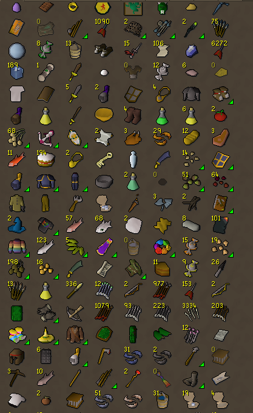
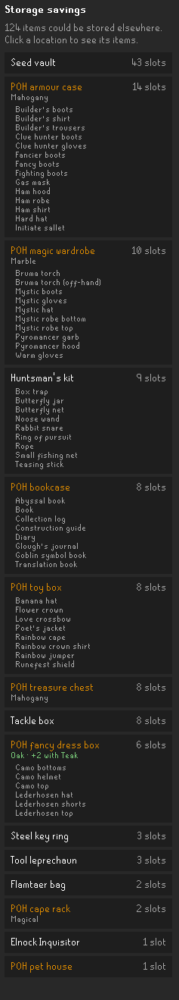
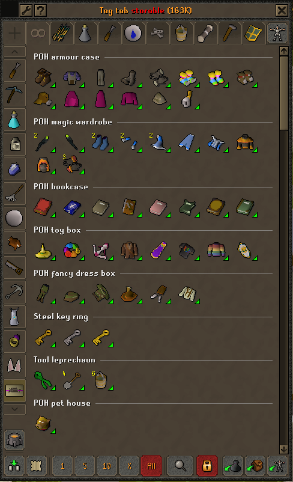
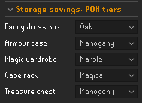
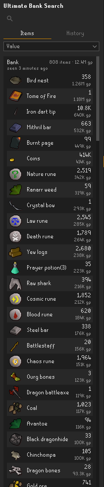
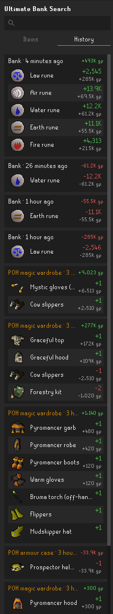

# Ultimate Bank

A bank toolkit for [RuneLite](https://runelite.net) with two sidebar panels:

- **Ultimate Bank Savings** finds banked items that could be stored somewhere else, and which storage upgrades free
  the most bank space.
- **Ultimate Bank Search** shows everything you own across your bank and POH storage, and what each visit changed.

> **New in 1.4:** Ultimate Bank Search covers your seed vault, tackle box, kits, pet house, tool leprechaun and
> fossil storage, and **Bank Tweaks** makes the "+" tag tab button list your tag tabs.
> See the [changelog](CHANGELOG.md) for every version.

## Ultimate Bank Savings
Open your bank: items that could live somewhere else get a marker, and the panel (chest icon) ranks where the space
would come from.

<table>
  <tr>
    <td align="center" valign="top">
      <br>
      <sub>Markers on items that could be stored outside the bank</sub>
    </td>
    <td align="center" valign="top">
      <br>
      <sub>Each storage, the bank slots it frees,<br>your POH tier and what an upgrade adds</sub>
    </td>
  </tr>
</table>

- **Markers:** every storable item is marked. Hover it to see where it can go (POH costume room, bookcase, pet
  house, tackle box, seed vault, tool leprechaun, STASH units and more) and how many your POH already holds.
- **Upgrade ranking:** storage sorted by bank slots freed. Click a row to list its items.
- **POH tiers:** detected when you visit your costume room, so only what fits is suggested. Upgrade hints only name
  furniture your Construction level can build.
- **`storable` tag tab:** every storable item in one bank tab, grouped by where it goes. The order holds while you
  withdraw, and clicking a group's title shows only that storage.
- **Ignore list:** shift-right-click an item › *Ignore storable*. Best-in-slot items are never flagged by default.
- **Works before you open the bank,** from the last time you saw it.
- **Per character:** POH tiers, storage locations and STASH options are remembered for each character.

<table>
  <tr>
    <td align="center" valign="top">
      <br>
      <sub>The <code>storable</code> tab, one titled group per storage</sub>
    </td>
    <td align="center" valign="top">
      <br>
      <sub>POH tiers: auto-detected, or pick one per storage</sub>
    </td>
  </tr>
</table>

## Ultimate Bank Search
A panel (magnifier icon) that remembers your bank and storage, per character: the POH costume room storages and pet
house, seed vault, tackle box, huntsman's kit and forestry kit (open each once so it's recorded), and your tool
leprechaun and fossil storage (recorded when you log in).

- **Items:** everything you own, grouped by location, with counts, values and when you last saw it. Search by item
  or location to find where something is.
- **Bank value:** the total of everything you own (or of what you searched for), each item's share on hover, sorted
  by value, quantity or name, at GE price or high alch value.
- **History:** what each visit to the bank or a storage took out or put in, newest first, with the value change.

<table>
  <tr>
    <td align="center" valign="top">
      <br>
      <sub>Items: everything in a location, most valuable first</sub>
    </td>
    <td align="center" valign="top">
      <br>
      <sub>History: what each visit took out or put in</sub>
    </td>
  </tr>
</table>

## Bank Tweaks
Small changes to what clicks in the bank do. Each only reorders a menu's own options.

- **Left-click: view tag tabs:** the "+" button below your tag tabs lists your tag tabs. Right-click it to make a
  new tab.

## Settings
Everything is under **Configuration › Ultimate Bank**, and each panel can be turned off on its own:

| Section | What's in it |
|---|---|
| Bank Savings: General | Markers, panel, `storable` tab, STASH units, ignore list |
| Bank Savings: Locations | Which storages to consider |
| Bank Savings: Tiers | Your POH costume room tiers (auto-detect or pick one) |
| Bank Search: General | Turn the search panel on, how many visits to keep, GE or high alch values |
| Bank Tweaks | Turn the bank tweaks on, and each tweak |

New features start **off** when you update, so nothing changes until you turn them on. Updated from 1.1 or earlier?
Turn on Ultimate Bank Search under *Bank Search: General*. Bank Tweaks (1.4) is under *Bank Tweaks*.

## Development
Requires JDK 11.

```sh
./gradlew build   # compile + tests
./gradlew run     # launch RuneLite with the plugin loaded
```

To log in to the dev client with a Jagex account, see
[Using Jagex Accounts](https://github.com/runelite/runelite/wiki/Using-Jagex-Accounts).

## Credits
Built on ideas and code from other BSD-licensed RuneLite plugins (Wasted Bank Space, Where's My Stuff, Bank Skill
Sorting) and storage data from the Old School RuneScape Wiki. See [docs/attribution.md](docs/attribution.md).
